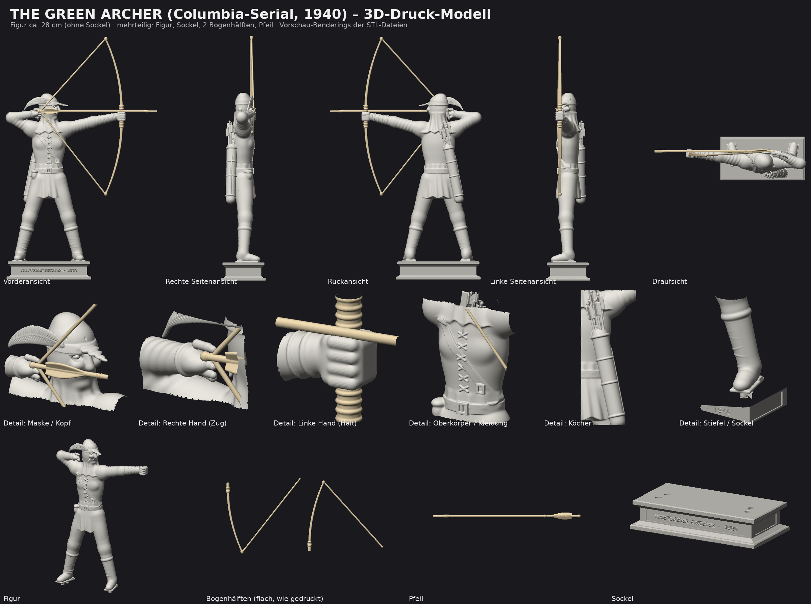

# The Green Archer (Columbia-Serial, 1940) – 3D-Druck-Modell

Mehrteiliges, druckoptimiertes STL-Modell des **Green Archer** im Stil des Columbia-Serials von 1940:
Figur im Moment des vollen Auszugs (gespannter Langbogen, Pfeil, Köcher) auf einem Sockel mit Gravur.



## Dateien

| Datei (`stl/druck/`) | Inhalt | Maße (mm) | Hinweis |
|---|---|---|---|
| `GreenArcher_01_Figur.stl` | Figur mit Hut, Gesichtstuch, Wams, Köcher, Händen | 198 × 57 × 284 | steht auf Fuß-Zapfen, Stützen nötig (Arme, Feder) |
| `GreenArcher_02_Sockel.stl` | Sockel mit Gravur „THE GREEN ARCHER · 1940“ und 4 Zapfenbuchsen | 140 × 72 × 30 | ohne Stützen druckbar |
| `GreenArcher_03_Bogen_oben.stl` | obere Bogenhälfte + halbe Sehne | 139 × 131 × 9 | liegt flach auf dem Druckbett |
| `GreenArcher_04_Bogen_unten.stl` | untere Bogenhälfte + halbe Sehne | 138 × 140 × 9 | liegt flach auf dem Druckbett |
| `GreenArcher_05_Pfeil.stl` | Pfeil mit Befiederung und Blattspitze | 198 × 9 × 8 | Brim/Stützen empfohlen |

`stl/GreenArcher_komplett_zusammengebaut.stl` zeigt alles in Endposition (nur zum Ansehen/Anprobieren, reduzierte Auflösung, 250 × 72 × 402 mm).

Alle Teile sind wasserdicht (je ein geschlossener Körper). Die Passungen wurden rechnerisch geprüft:
**0 mm³ Überschneidung** zwischen allen Teilen.

## Größe

* Figur: **ca. 28 cm** (Fußsohle bis Federspitze), mit Sockel ca. 31 cm.
* Zusammengebaut (mit Bogenspitze) ca. 40 cm hoch. Für Drucker mit ~250 mm Bauhöhe im Slicer auf **ca. 75–80 %** skalieren
  (alle Teile gleichmäßig skalieren, auch Sockel und Bogen – die Zapfenpassung skaliert mit).

## Zusammenbau

1. Figur mit den 4 Fußzapfen in den Sockel stecken (0,25 mm Spiel, mit Kleber fixieren).
2. Die zwei Bogenhälften mit ihren Zapfen von oben und unten in die Bohrung der linken Faust stecken
   (Bohrung Ø 5,3 mm, Zapfen Ø 4,7 mm) und verkleben. Die Sehnenenden treffen sich am Nockpunkt der Zughand.
3. Pfeil an der Nocke zwischen die Finger der rechten Hand legen und auf der linken Faust ablegen (Klebepunkte).

## Druck-Empfehlung

* **Resin:** 0,03–0,05 mm Schichthöhe; Figur ca. 30° kippen und Stützen automatisch erzeugen.
* **FDM:** 0,1–0,15 mm, Düse 0,4 (besser 0,25–0,3 für Gesicht/Feder), Tree-Supports. Bogenhälften und Pfeil liegen flach.
  Die dünnste Struktur ist die Sehne (Ø 1,9 mm) – sie darf bei Bedarf abgeschnitten werden; der Bogen steht auch ohne.
* Mindestmaße im Modell: Federkiel/Befiederung ≈ 1,1 mm, Pfeilschaft Ø 2,7 mm, Bogenarm 2,1–3,8 mm dick.

## Was wurde gegenüber deiner Bildvorlage angepasst – und warum

**Film-Optik (Green Archer, 1940).** Laut den Beschreibungen, die ich finden konnte, trägt die Figur im Serial einen
spitzen Robin-Hood-Hut mit Feder, Strumpfhose, Wams (Jerkin) und ein lose sitzendes Tuch über dem Gesicht
([TCM](https://tcm.com/tcmdb/title/496387/the-green-archer), [Medleyana-Rezension](https://medleyana.com/2015/06/22/fates-worse-than-death-the-green-archer-1940/)).
Das Bild zeigt dagegen einen enganliegenden Ganzkörperanzug mit Kapuze und langem Umhang. Deshalb:

* Hut mit Rollrand, Schirm und **Feder** statt Kapuze
* **Gesichtstuch** mit Augenöffnungen, Nase und Zugfalten, Knoten mit Zipfeln im Nacken, Tuch fällt als Kragen auf die Schultern
* **Wams** mit Brustschnürung, Gürtel mit Schnalle, Beutel, Saum mit Schlitzen, Strumpfhose, Stiefel mit Umschlag und Kreuzschnürung
* **Kein langer Umhang** – in den Beschreibungen kommt keiner vor; er wäre außerdem schlecht druckbar
* Köcher mit 7 Pfeilen und Schultergurt (wie im Bild), linker Unterarm mit Armschiene (Bracer)

**Druckbarkeit.** Bogen, Pfeil und Sockel sind eigene Teile; der Bogen ist in zwei Hälften geteilt, damit er durch die Faust
gesteckt werden kann; Kontaktflächen sind sauber freigeschnitten; flache Auflagen für Bogenteile; Zapfen-Steckverbindungen.

## Ehrliche Einschränkungen

* Das Modell ist **prozedural erzeugt** (Skript in `build/`), nicht von Hand gesculptet wie ein Studio-Miniatur. Anatomie,
  Hände und Gesicht sind stilisiert; Finger sind vereinfacht.
* Ich konnte **keine Filmbilder** einsehen, nur Textbeschreibungen. Details wie Schnitt der Mütze, Länge des Wamses
  und Stiefelform sind daher eine plausible Interpretation, kein exakter Nachbau. Ein Screenshot aus dem Serial würde helfen, das zu schärfen.
* **Nicht im Slicer/Drucker getestet.** Geprüft wurden nur Wasserdichtheit, Überschneidungen und Maße per Skript.
  Die ausgestreckten Arme, die Feder und der Köcher brauchen im FDM-Druck Stützen.
* Für den Look „Grün“ bitte bemalen (Hut/Wams/Tuch grün).

## Neu erzeugen

```bash
pip install numpy scipy scikit-image trimesh manifold3d fast-simplification shapely mapbox-earcut matplotlib pillow
python3 build/green_archer.py --h 0.4 --out stl/zusammengebaut --faces 750000   # ca. 1 Minute
python3 build/export_print.py        # druckfertige Ausrichtung + Passungsprüfung
python3 build/make_previews.py       # Vorschaublatt
```

Parameter wie Kopfdrehung, Zugarm, Bogenlänge usw. stehen am Anfang von `build/green_archer.py`.
